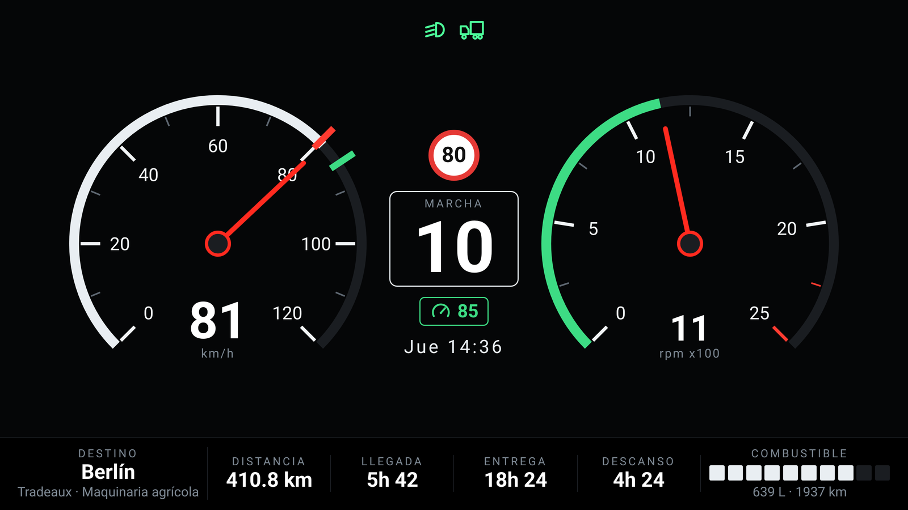

# ETS2 HUD

Usá una tablet o un celular (aunque sea viejo) como **tablero de tu camión** en Euro Truck Simulator 2 o American Truck Simulator.



> 🇬🇧 *Live dashboard for ETS2/ATS that runs in any browser on your local network. Node.js reads the game telemetry and streams it over WebSocket to a tablet. Instructions below are in Spanish, but the commands are the same.*

## Qué muestra

- **Velocímetro y cuentavueltas con agujas**, animadas a 60 fps. En el velocímetro hay marcas para el límite de velocidad y el control crucero, y en el cuentavueltas, una zona verde de consumo eficiente.
- **Marcha, cartel de velocidad máxima, control crucero** y la hora del juego.
- **Testigos** que aparecen solo cuando están activos, como en el juego:
  - Luces e intermitentes: bajas, altas (incluido el destello), balizas, baliza giratoria.
  - Frenos: freno de mano, luz de freno, freno motor, retarder (con el nivel).
  - Camión: bloqueo de diferencial, eje elevado, remolque, limpiaparabrisas.
  - Alertas: combustible, AdBlue, aire, aceite, temperatura y batería.
- **Ruta:** destino, distancia, tiempo de llegada, tiempo límite de entrega y descanso.
- **Combustible** en 10 segmentos, con litros y autonomía.
- Se puede **agregar a la pantalla de inicio** y abre en pantalla completa, en horizontal.
- Anda en **navegadores viejos**: el cliente está escrito en ES5 y, si no hay WebSocket, usa polling.

## ¿En qué lo puedo usar?

En **cualquier dispositivo con navegador** que esté en la misma red que la PC. Es ideal para darle una segunda vida a algo que tengas guardado en un cajón:

| Dispositivo | Notas |
|---|---|
| 📱 **Tablet Android** | Probado en una tablet Lenovo con Android viejo. |
| 📱 **Celular en desuso** | Android o iPhone: se pone en horizontal y queda como un tablero chico. |
| 📱 **iPad** | Desde Safari: *Compartir → Agregar a pantalla de inicio*. |
| 💻 **Notebook vieja** | Abrís la dirección en el navegador y apretás F11 para pantalla completa. |
| 🖥️ **Segundo monitor** | En la misma PC, abrí `http://localhost:8080` en una ventana del navegador en pantalla completa. |
| 📺 **Smart TV o Raspberry Pi con pantalla** | Cualquier navegador moderno sirve. |

- **Navegadores viejos:** el código del lado del dispositivo es JavaScript ES5 con CSS compatible, así que debería andar en Android 4.4 o superior. Si el dispositivo no soporta WebSocket, el HUD usa polling automáticamente.
- **Varios dispositivos a la vez:** podés tener el HUD abierto en la tablet y en el celular al mismo tiempo.
- **Pantalla:** está pensado para usarse **en horizontal**. Se adapta a cualquier resolución.

## Requisitos

- PC con **Windows 10/11 de 64 bits** y ETS2 o ATS.
- **Node.js 22 o superior.** En el instalador, tildá *"Automatically install the necessary tools"*, porque la librería de telemetría se compila al instalar.
- Una tablet o un celular conectado a la **misma red** que la PC.

## Instalación

### 1. Plugin de telemetría del juego

1. Bajá **scs-sdk-plugin v1.12.1** desde [RenCloud/scs-sdk-plugin](https://github.com/RenCloud/scs-sdk-plugin/releases).
2. Copiá `Win64/scs-telemetry.dll` en:
   ```
   ...\steamapps\common\Euro Truck Simulator 2\bin\win_x64\plugins\
   ```
   Si la carpeta `plugins` no existe, creala. Para encontrar la carpeta del juego: en Steam, clic derecho en el juego → *Administrar → Explorar archivos locales*.

### 2. El HUD

```
git clone https://github.com/myzock/ETS2-HUD.git
cd ETS2-HUD
npm install
```

## Uso

```
npm start
```

1. La consola muestra la dirección que tenés que abrir, por ejemplo `http://192.168.0.15:8080`.
2. Abrí el juego y aceptá el aviso de **"Advanced SDK features"**.
3. En la tablet, abrí esa dirección en Chrome.
4. Opcional: en el menú ⋮, elegí **Agregar a pantalla principal** para tenerlo como app.

### Probar sin el juego

```
npm run demo
```

Levanta el HUD con un camión simulado.

### Opciones

| Variable | Default | Para qué |
|---|---|---|
| `PORT` | `8080` | Puerto del servidor |
| `HZ` | `20` | Actualizaciones por segundo hacia la tablet |

Ejemplo en PowerShell: `$env:HZ=10; npm start`

Para ver el diagnóstico, agregá `?debug` a la dirección. Muestra cuántos datos llegan por segundo, a cuántos cuadros por segundo se dibuja y el tipo de conexión.

## Problemas comunes

| Problema | Solución |
|---|---|
| `npm.ps1 no se puede cargar… ejecución de scripts deshabilitada` | Corré `Set-ExecutionPolicy -Scope CurrentUser RemoteSigned` en PowerShell. |
| `npm install` falla con `gyp ERR! find VS` | Faltan las Build Tools de Visual Studio con el **Windows SDK**. Instalá la carga "Desarrollo para el escritorio con C++" o corré `winget install Microsoft.VisualStudio.2022.BuildTools --override "--wait --passive --add Microsoft.VisualStudio.Workload.VCTools --includeRecommended"`. |
| La tablet no abre la página | Permití Node.js en el firewall de Windows (redes privadas) y usá la IP que muestra la consola. |
| Dice "Esperando al juego…" | El DLL no está en `bin\win_x64\plugins\`, o no aceptaste el aviso del SDK al abrir el juego. |
| Se apaga la pantalla de la tablet | En Opciones de desarrollador, activá **"Pantalla activa"**. |

## Limitaciones

- Los viajes del **DLC Coaches** (colectivos) no se informan como trabajo en el plugin v1.12.1. En ese caso el HUD muestra "Ruta en GPS", con la distancia y el tiempo de llegada.
- Como se sirve por HTTP en la red local, Chrome no ofrece "Instalar app". Usá "Agregar a pantalla principal".

## Cómo está hecho

```
server.js           Node.js: lee la telemetría y la manda por WebSocket (/ws) y HTTP (/api/state)
public/cluster.*    Tablero: HTML + CSS + JS en ES5, relojes en SVG
public/manifest.json, sw.js, icons/   Para agregarlo como app
```

## Créditos

- [trucksim-telemetry](https://github.com/kniffen/TruckSim-Telemetry) de kniffen, para leer la telemetría desde Node.js.
- [scs-sdk-plugin](https://github.com/RenCloud/scs-sdk-plugin) de RenCloud, el plugin que expone los datos del juego.

Proyecto de fans, sin relación con SCS Software. Euro Truck Simulator 2 y American Truck Simulator son marcas de SCS Software.

## Licencia

[MIT](LICENSE)
